# 📓 Beetle Build Log

The story of BETL-001, oldest first. Each chapter covers what changed and why, and what fought back.
For the robot as it stands today, see [`docs/current-state.md`](docs/current-state.md). For plans, see
[`docs/whats-next.md`](docs/whats-next.md).

| Chapter | When | One line |
|---|---|---|
| [1. Ignite & the plan](#chapter-1--ignite--the-plan) | Jun 2026 | X5 boots, YOLO runs on the BPU, the robot exists on paper |
| [2. Bring-up on a cart](#chapter-2--bring-up-on-a-cart) | Jul 2026 | Encoders, a spinning lidar, and SLAM that the X5 couldn't carry |
| [3. The swerve that wasn't](#chapter-3--the-swerve-that-wasnt) | Jul 18 | Found out in CAD, not in aluminum, that the steering idea was wrong |
| [4. Stage 3 ships](#chapter-4--stage-3-ships) | Jul 28 | Dead reckoning, a 3D scanner, and a clean BPU benchmark |
| [5. Mecanum and the road](#chapter-5--mecanum-and-the-road) | Sep 2026 | New drivetrain, suspension, conferences, a ROSCon talk |
| [6. Regroup](#chapter-6--regroup) | Oct 2026 | Mentor video, docs rebuilt for life after the competition |
| [7. Shenzhen sprint](#chapter-7--shenzhen-sprint-in-progress) | Nov 2026 → | Offline voice and translator working, eyes and shell in progress |

---

## Chapter 1 — Ignite & the plan

*June 2026 · [Stage 1 report](docs/rdk-challenge/stage1.md) · [Stage 2 proposal](docs/rdk-challenge/PROPOSAL.md)*

I registered for D-Robotics' **Robotics Dream Keeper Challenge** and ordered an RDK X5. Stage 1 meant flashing it,
networking it, and getting a first on-device AI task working. The first YOLO detection ran on the BPU
from the D-Robotics stereo camera.

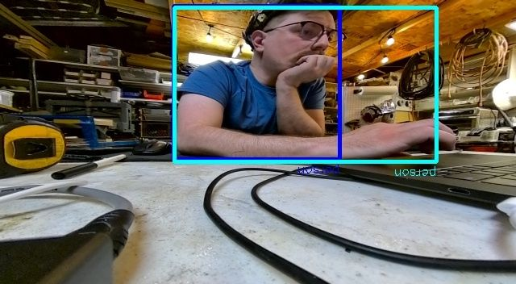 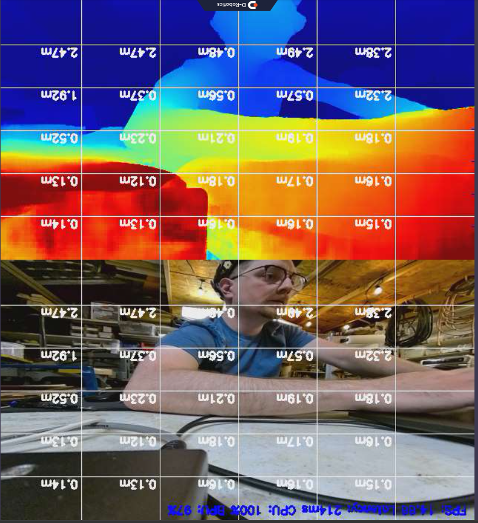

The Stage 2 proposal described **an expressive lidar robot**: 2D mapping, concurrent BPU detection,
modular payloads, LED eyes, a status panel and a deterministic voice. Personality was part of the design
from day one. The build strategy was to keep the electronics separate from the welded frame, so bring-up
could start on a "breadboard chassis" while weld stock was still in the mail.

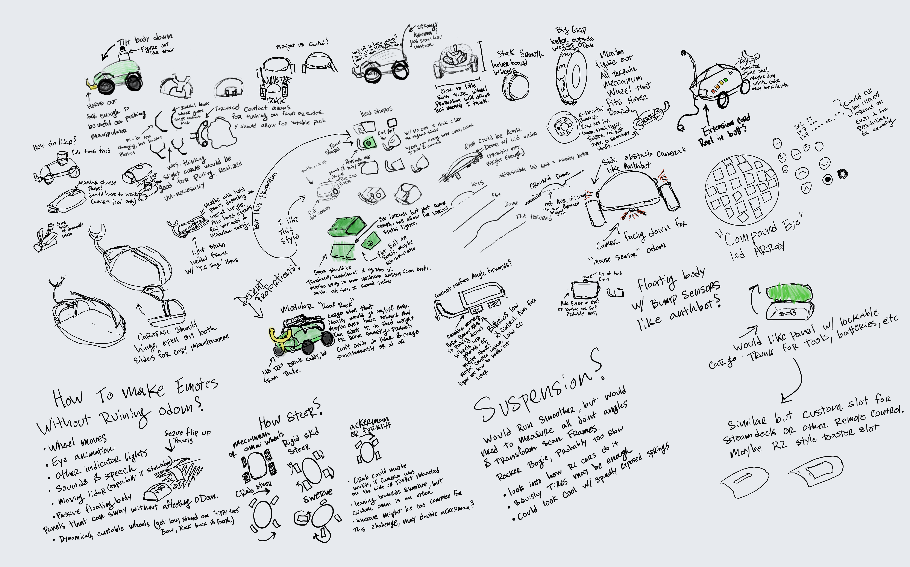

---

## Chapter 2 — Bring-up on a cart

*July 2026*

The robot went up on a cart with its wheels off the ground, so it could be pushed around by hand and SLAM
work could start without fighting the drivetrain.

**Encoders, round one.** The plan was AS5600 magnetic encoders feeding an "odometry Pico." They turned out to
be too slow for the ODESC's commutation loop. I switched to **AS5047P** on SPI, wired *straight into the
drivers* for closed loop. That deleted the odometry Pico entirely. The AS5047Ps arrived without magnets, so I bought
more AS5600 kits and harvested their diametral magnets.

**Teleop, round one.** It drove "fast and violently." Torque mode with no speed regulation meant the
sticks dumped raw current into the motors. A brake-on-release experiment made it *worse*: a wrong hall
velocity sign caused a 5-second full-speed runaway. Lessons: velocity mode only, and a real deadman.

**The poor-man's 3D lidar.** A single RPLIDAR A1, canted 90° on a belt-driven rotating stage, sweeps the whole
sphere. The trick is that every point gets one TF lookup at its own timestamp, which corrects for the robot's
motion and the stage's rotation in one step:

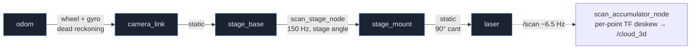

Stage control runs on an RP2350 in MicroPython. The scan came out stable on the first real try, which is when "poor-man's 3D" stopped being a theory.

**SLAM, the long way round.**

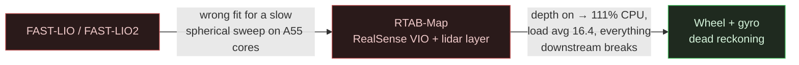

RTAB-Map was the right algorithm on the wrong computer. Turning on RealSense depth alone was enough to
overload the X5's CPU. It came out of the live chain. Its CPU cost lived on as the "concurrent load" case in the benchmark.

---

## Chapter 3 — The swerve that wasn't

*July 18, 2026*

I sat down to CAD the encoder mounts and ended up redesigning the drivetrain.

Skid steer was scrubbing and fighting the motors' torque in turns, so I wanted steering. My first idea was to
link the front and rear wheel on each side. Talking it through showed that this **isn't Ackermann, it's crab steer**.
Ackermann pairs wheels *side to side*, because the inside wheel needs a sharper angle. Pairing them front to back forces two wheels
on different-radius arcs to stay parallel, which is the same scrub I was trying to escape. I found that out in CAD instead of in aluminum.

So the design became **limited-arc swerve**:

- The X5 owns the inverse kinematics. A steering Pico closes four position loops over **plain CAN** (no micro-ROS; four numbers in and four out don't need DDS)
- AS5600 encoders on the knuckles via a TCA9548A I²C mux (they all share the fixed address 0x36), beam-break homing with flags at both ends of travel
- Steering on 12 RPM gear motors for v1, with the reduction on a bolt-on plate so a better motor would only need a reprint

**It was never built.** There wasn't time to make steering before Stage 3 shipped, and later mecanum delivered
holonomic motion with no steering hardware at all. The design is [shelved, not retired](docs/whats-next.md#the-shelf).

---

## Chapter 4 — Stage 3 ships

*July 28, 2026 · [demo video](https://youtu.be/_VSdEOZrcUg) · [architecture](docs/architecture.md) · [benchmark](docs/benchmark.md) · [failure log](docs/failure-recovery.md)*

It shipped late but honest: skid steer, dead reckoning (explicitly *not* SLAM), the spherical scanner, and YOLOv8n
INT8 on the BPU, all running concurrently.

**The headline result:** the BPU and the CPU really are separate resources.

| Stage | Isolated | Under full CPU load | Δ |
|---|---|---|---|
| YOLOv8n inference (**BPU**) | 7.25 ms | 7.47 ms | **+3%** |
| Preprocess (CPU) | 8.85 ms | 12.29 ms | +39% |
| Postprocess (CPU) | 4.21 ms | 5.03 ms | +19% |

**What made it reliable:**

- **Gated bringup** (`beetle_up.py`). Each stage is *verified* before the next one starts: topic rates, TFs, ports.
  The key gate checks that `odom → laser` exists **and is moving**. A frozen transform passes every naive check
  and silently produces a useless cloud.
- **A single path to the motors**, with six safety layers from the Deck deadman down to the hardware e-stop.
- **An always-on agent** (systemd) that broadcasts a discovery beacon, serves the browser console and supervises
  bringup. If bringup fails, something outside ROS still shows you why.

**The bug list is the real treasure.** Eleven bugs, nearly all of them *silent*: a RealSense QoS mismatch that
fed odometry nothing for weeks, `-p max_wheel_tps` silently ignored because the parameter was never declared,
YAML reading `y` as `true`, a ROS node name that didn't match its filename, so three console buttons looked
dead. The lesson underneath all of them: **prefer loud failures.** → [`docs/failure-recovery.md`](docs/failure-recovery.md)

Measured constants that came out of it: wheel radius **0.0765 m** (the old eyeballed 0.0825 m was over-reporting
distance by 7.8%), and gyro *bias* dominated heading error by about 150× over gyro scale. → [`docs/calibration.md`](docs/calibration.md)

---

## Chapter 5 — Mecanum and the road

*September 2026*

**Skid steer → mecanum.** Skid steer kept fighting the motors' torque, and swerve needed steering hardware there wasn't
time to build. Mecanum gives strafing and diagonals with the existing four hub motors.

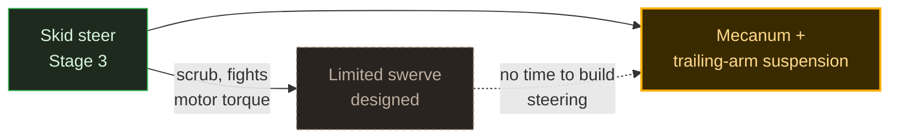

A rigid four-wheel chassis lifts a wheel on any uneven floor, and with mecanum that breaks the strafe kinematics.
So every wheel got its own **trailing arm with a shock**. The AS5047Ps came off, since their mounts didn't fit the new
geometry, and the drives fell back to the hub motors' hall sensors (90 counts/rev). The lidar was remounted flat for future
2D SLAM, and a Raspberry Pi 4B went in as the SLAM coprocessor-to-be.

  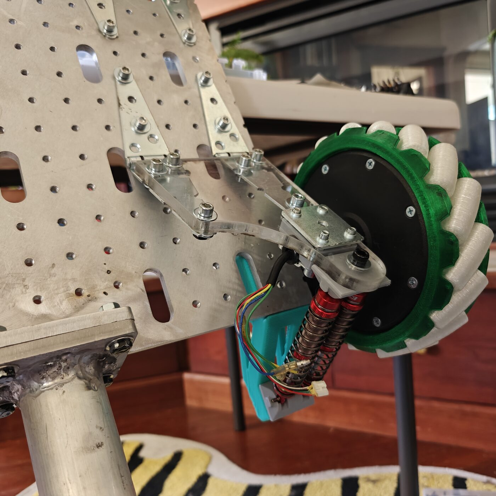
  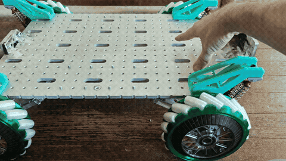

One trailing arm per wheel. Every mecanum wheel stays on the floor.

**On tour.** Beetle went to conferences abroad in teleop-only mode. What people loved most was **watching it drive sideways and
at angles**. I gave a **lightning talk at ROSCon 2026**, and D-Robotics interviewed me about the build.

  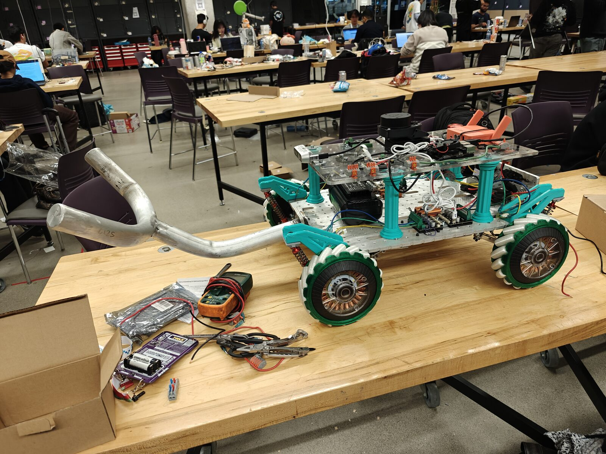
  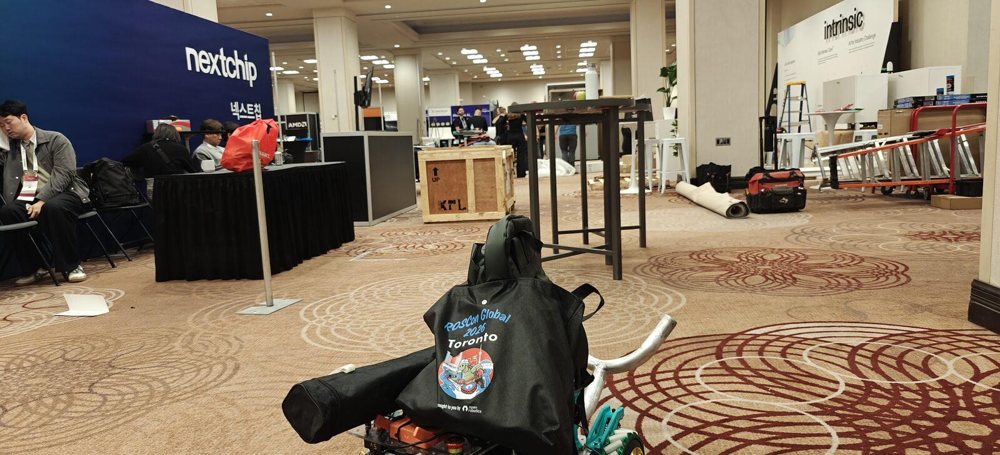

  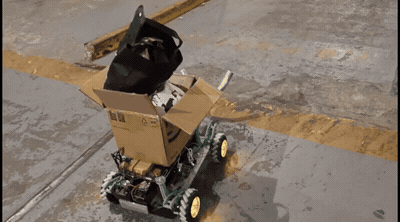

September 2026 on tour: late-night fixes at the bench, the show floor, and a side job as a luggage cart.

**The night-before unlock.** Mecanum crabbing on conference carpet needs real torque, and the drives didn't have it. The cause
was a **torque constant that had been wrong all along**. The firmware default was 0.04, and a later guess of 0.517 was also wrong.
Measured, it's **0.245**, and since every current command is scaled by Kt, every command had been off. With Kt fixed, current-control bandwidth
could go from 100 to **300**. The low value had only ever been a workaround to stop deadline-miss errors caused by the wrong Kt.

**Crab-lock.** In velocity mode, the force at stall is proportional to the speed *error*. So the D-pad speed trim was also
trimming push, and crabbing on carpet needed the full command. The fix that night was a crab-lock button that strafes at full lateral
speed, exempt from the trim.

**The failure that taught the most.** The robot ran on two Ryobi 40 V-class tool packs, since the EGO pack it uses at home is too big to fly with. As they sagged, the X5 stayed
alive but the motors died:

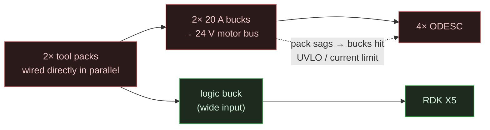

The ODESCs' `vbus_voltage` read the *regulated* 24 V, so nothing reported a low battery until the motors simply stopped.
The drivers knew what was wrong, and nothing told me. That single failure became sprint priority #3: a gauge upstream of
the bucks, and ODESC error codes surfaced to the operator.

---

## Chapter 6 — Regroup

*October 2026*

The competition was over. I made a mentor tips video for the next RDK Challenge cohort, styled after Beetle's amber CRT
teleop HUD. Beetle's docs were rebuilt for a project with no deadlines: one "as-built" doc, one "directions" doc and this log.

The sprint for Maker Faire Shenzhen (early December) was set: **eyes, voice and the shell first**, then encoders, power and
follow-me. One more research note fell out of this. The ROSCon X5 demo booth (multi-person skeletons, hand gestures, age guesses) was
running stock **TROS nodes**, including `reid` for person re-identification, all with X5 support. That turned follow-me
from a research project into an integration job.

---

## Chapter 7 — Shenzhen sprint (in progress)

*November 2026 →*

- **Voice:** a working, fully offline prototype → [`ros2_ws/src/betl_voice`](ros2_ws/src/betl_voice/). It needs no cloud, so it
  works in China without a VPN. Say "Hey Beetle" and the LED dot glides toward you. "Beetle, please translate…" goes
  English ↔ Chinese out loud. "**Stop**" works mid-sentence with no wake word and latches `/betl/estop`. It can also save and
  search notes and use an optional small local LLM. All audio plays *through* the reSpeaker Flex, so its echo canceller
  can ignore Beetle's own voice.

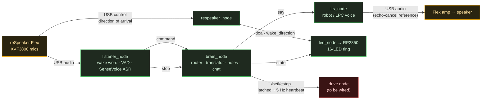

  Under the hood: sherpa-onnx for keyword spotting, VAD and bilingual SenseVoice ASR, Argos (OPUS-MT) for translation,
  and Piper/espeak voices with an optional 10-pole, 8 kHz **Speak & Spell LPC** re-synthesis. `scripts/betl_doctor.py`
  checks the whole chain before a demo. Still to do: mount it in the shell and have the drive node obey `/betl/estop`.
- **Eyes:** moving from the low-res LED ring prototype to a tight-pitch square grid in each dome. A Pico renders the layer stack
  (googly physics → gaze → lids → blink → glyph), and the X5 only sends expression, gaze and a heartbeat.
- **Shell:** green translucent acrylic and smoked-grey eyes, lived-in cyberpunk. It still has to come apart for a flight.

*This chapter will grow as the sprint goes.*

<!--
New entry template:

## Chapter N — Title
*Month YYYY*

What changed and why, in a few paragraphs. A diagram if the change is structural.
Photos go in media/log/YYYY-MM-DD-*.jpg
-->
