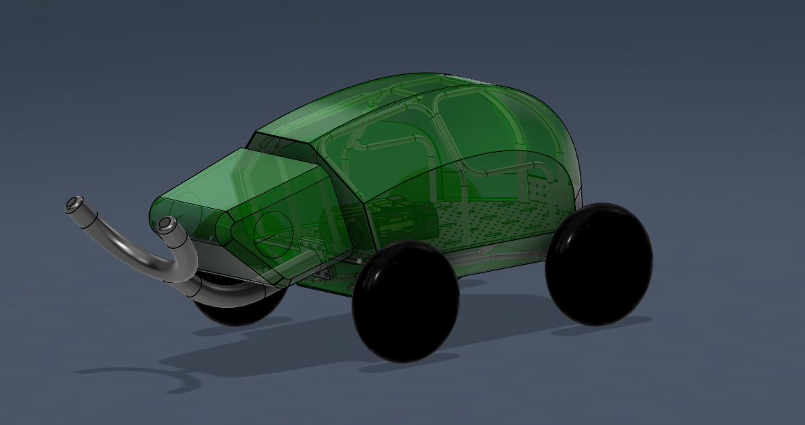
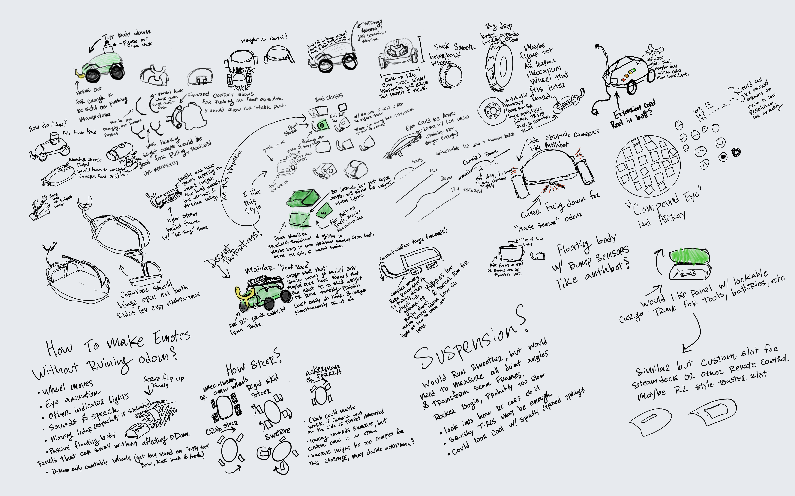

# BETL (BPU-Education, Transport, Lidar), pronounced "Beetle"



A scratch-built, bio-inspired expressive lidar mobile robot on the **RDK X5**, built for the
**Robotics Dream Keeper Challenge** (D-Robotics, 2026). It drives, builds a 3D point cloud
from a spinning 2D lidar, and runs BPU-accelerated object detection concurrently — a
modular research platform with personality baked in from the start.

> **Status:** Stage 3 (Launch) submission. Skid-steer drivetrain, RDK X5 BPU running
> YOLOv8n INT8 concurrently with a CPU-side dead-reckoning + lidar-reprojection stack.
> See [`docs/architecture.md`](docs/architecture.md) for what's actually running today —
> it supersedes the Stage 2 design in [`PROPOSAL.md`](PROPOSAL.md) in a few concrete ways
> (dead reckoning instead of SLAM, notably). Demo video: **https://youtu.be/_VSdEOZrcUg**.

---

## What it is

- **4-wheel skid-steer** base: hoverboard hub motors, 4× Flipsky ODESC V4.2 drivers
  (USB; CAN wired but not brought up), AS5047P wheel encoders feeding odometry directly off
  the drivers.
- **Concurrent perception:** YOLOv8n INT8 detection on the **BPU** + wheel/gyro dead
  reckoning and lidar-cloud accumulation on the **CPU** — separate compute units, so BPU
  inference holds flat under CPU load (measured: +3% mean latency under concurrent load —
  see [`docs/benchmark.md`](docs/benchmark.md)).
- **Pose:** RealSense D435i RGB + IMU for gyro yaw, ODESC wheel encoders for forward
  velocity, fused into dead-reckoning odometry (`nodes/wheel_odom_node.py`). **This is not
  SLAM** — no loop closure, no global correction. RTAB-Map was tried first, overloaded the
  CPU with depth enabled, and was pulled from the live chain; its CPU cost is still used as
  the concurrent-load benchmark case.
- **"Poor-man's spherical lidar":** an RPLIDAR A1 canted 90° on an encoder-driven rotating
  stage, reprojected into a 3D point cloud via the live TF chain
  (`odom → camera_link → stage_base → stage_mount → laser`).
- **Personality, in progress:** round-array LED eyes, a scrolling status panel, and a
  deterministic offline voice are part of the design (see `PROPOSAL.md`) — not part of the
  Stage 3 core deliverable and not claimed as working here.



## Architecture

Full write-up, node graph, TF chain, and the concurrent-workload story:
[`docs/architecture.md`](docs/architecture.md). System-flow and node-graph *design*
diagrams from the Stage 2 proposal (Mermaid, some details since superseded) are in
[`PROPOSAL.md`](PROPOSAL.md).

**Single path to the motors.** Every velocity source — Deck teleop, the command watchdog,
the software e-stop — funnels through one drive node, backed by the ODrive firmware
watchdog and an independent hardware e-stop. Full layer list:
[`docs/architecture.md#safety--single-path-to-the-motors`](docs/architecture.md#safety--single-path-to-the-motors).

## Quick Start

Everything here runs as plain Python scripts against a sourced ROS 2 (Humble / tros.b)
environment — not (yet) installed colcon packages, except `scan_stage` (see
[`ros2_ws/src/scan_stage/`](ros2_ws/src/scan_stage/)). This matches how the robot is
actually deployed today; turning `nodes/` into real ROS 2 packages is a documented
follow-up, not done for the competition build.

```bash
git clone https://github.com/RFisaac/BETL-001.git
cd BETL-001
```

**On the robot (RDK X5):**

```bash
scp nodes/*.py systemd/beetle-agent.service root@<X5_IP>:/userdata/
# scan_stage is a real colcon package — see ros2_ws/src/scan_stage/ and
# docs/deploy.md section 2 for why it can't just be copied to /userdata.
# console/beetle_console.html goes to the web root the agent serves — see docs/deploy.md.

ssh root@<X5_IP>
source /opt/tros/humble/setup.bash
cd /userdata
python3 beetle_up.py --drive-only          # camera + drives + odometry, gated bring-up
# once that's green:
python3 beetle_up.py --spin --console      # full stack: lidar, stage, cloud, console
```

`beetle_up.py` checks each stage before starting the next and prints exactly what failed
if something doesn't come up — see [`docs/baseline_run.md`](docs/baseline_run.md) for the
full gated sequence and what each gate means. `beetle_bringup.launch.py` is a faster,
ungated alternative once the hardware is known-good.

**On the Deck / laptop:**

```bash
python3 tools/beetle_find.py --url     # discovers the robot, prints the console URL
python3 tools/deck_teleop.py --host $(python3 tools/beetle_find.py)
```

Full deployment checklist (what goes where, in what order, and the two ordering traps that
aren't obvious): [`docs/deploy.md`](docs/deploy.md).

## Safe shutdown / e-stop

- **Hardware e-stop** — physical cutoff, independent of any code, always available.
- **Software `/estop` topic** (`std_msgs/Bool`) — latches all four drives to IDLE.
- **Deck deadman** — release zeros the command.
- **Command + firmware watchdogs** — a dead link or a dead process drops the drives to idle
  within about a second, with no operator action required.

Full detail and ordering: [`docs/architecture.md#safety--single-path-to-the-motors`](docs/architecture.md#safety--single-path-to-the-motors).

## Benchmark

BPU YOLOv8n inference: **7.25 ms mean isolated, 7.47 ms mean concurrent with CPU-side
load — +3%**, while CPU-side pipeline stages degraded 19–39% under the same concurrent
run. Methodology, full tables, and the reproduction runbook:
[`docs/benchmark.md`](docs/benchmark.md).

## Known issues

Bugs found during Stage 3 bring-up with transferable lessons, automatic and manual
recovery paths, and the one open issue (an unresolved point-cloud overlay bug):
[`docs/failure-recovery.md`](docs/failure-recovery.md).

## Repository layout

```
README.md            This file
LICENSE               Apache 2.0
PROPOSAL.md           Stage 2: concept, architecture, engineering plan (+ diagrams) — historical
ROADMAP.md            Stage 2/3 milestone plan — historical, see the status note at the top
docs/
  architecture.md      Current (Stage 3) architecture — the doc that's actually kept live
  calibration.md        Measured constants: wheel radius, track width, gyro bias
  failure-recovery.md   Known bugs, recovery paths, the one open issue
  benchmark.md           Methodology, headline numbers, reproduction runbook
  baseline_run.md        Full gated bring-up sequence, step by step
  deploy.md               What file goes where, in what order
  odesc_quick_reference.md  ODESC driver config, wiring, error codes
nodes/                 Bare rclpy scripts, run directly on the X5 from /userdata
ros2_ws/src/scan_stage/  The one node that IS an installed colcon package
console/               Browser tuning/telemetry console + the older CRT HUD
tools/                 Run on the Deck or laptop, not the robot
systemd/               beetle-agent.service
media/                 Renders, stage 1 screenshots
```

## Follow the build

- **YouTube** (RustedFriend) — build log + the Stage 3 demo
- **Instagram / Threads** (RustedFriend) — visual updates
- **Discord** — running build log

## License

Apache License 2.0 — see [`LICENSE`](LICENSE).
