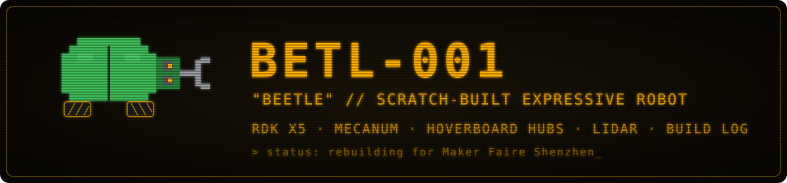
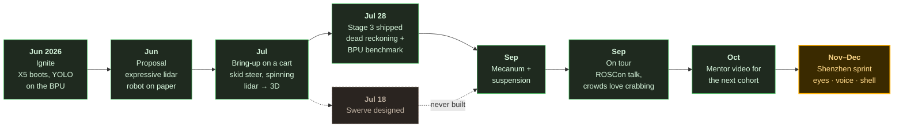
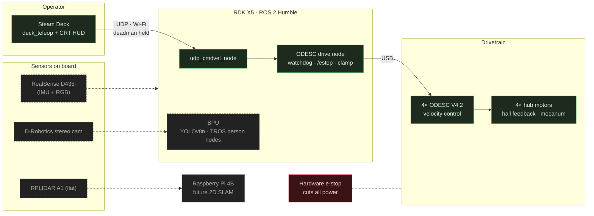

<p align="center">
  
</p>

<p align="center">
  <b>BETL</b> (BPU-Education, Transport, Lidar), pronounced <i>"Beetle"</i>, is a scratch-built,
  bio-inspired robot on a D-Robotics <b>RDK X5</b>.<br>
  It started as an entry in the <a href="docs/rdk-challenge/">Robotics Dream Keeper Challenge</a>.
  The challenge is over, and Beetle has become my ongoing hobby and research robot.
</p>

<p align="center">
  <a href="BUILD_LOG.md"><b>📓 Build log</b></a> ·
  <a href="docs/current-state.md"><b>🔧 What's on the robot now</b></a> ·
  <a href="docs/whats-next.md"><b>🧭 What's next</b></a> ·
  <a href="docs/rdk-challenge/"><b>🏁 Challenge archive</b></a> ·
  <a href="https://youtu.be/_VSdEOZrcUg">▶ Stage 3 demo</a>
</p>

---


## Right now (Nov 2026)

| | |
|---|---|
| **Drivetrain** | Mecanum on four 24 V hoverboard hub motors, trailing-arm shock suspension on every wheel, 4× Flipsky ODESC V4.2 |
| **Brain** | RDK X5 (8 GB), ROS 2 Humble / TogetheROS.Bot, systemd bringup |
| **Driving** | Teleop from a Steam Deck over UDP, with strafe, diagonals and a "crab-lock" button |
| **Voice** | Offline wake word, English ↔ Chinese translator, voice "stop" and a Speak & Spell voice, on the bench → [`betl_voice`](ros2_ws/src/betl_voice/) |
| **Autonomy** | None running. The Stage 3 dead-reckoning and 3D-scan stack is [parked, not deleted](docs/architecture.md) |
| **Shape** | Partly disassembled after a conference trip. It's being rebuilt with eyes, voice and a shell for **Maker Faire Shenzhen** (early Dec 2026) |

Full as-built details are in [`docs/current-state.md`](docs/current-state.md).

## The story so far



Each step has its own chapter, with the reasoning and the failures, in the **[build log](BUILD_LOG.md)**.

## How it's wired today



<sub>Solid = running. Dashed = installed but not in use yet.</sub>

## What's next

Here's the pre-Shenzhen sprint, in priority order. The full reasoning is in [`docs/whats-next.md`](docs/whats-next.md).

1. 👀 **Eyes**: a square LED grid in each dome, with googly physics and blinks · 🗣️ **Voice** on a reSpeaker Flex (prototype working → [`betl_voice`](ros2_ws/src/betl_voice/)) · 🐞 **Finish the shell**
2. 🧲 **AS5047P encoder mounts** for the mecanum wheels and suspension, so the drives get real closed-loop velocity
3. 🔋 **Power front end**: hot-swap any brand of battery, and a battery gauge that actually reads the battery
4. 🚶 **Follow-me** with voice and gesture commands, as the first real autonomy
5. 📟 An **80×16 side display** · 🌏 a **translator mode** · 🗺️ **2D SLAM** on the Pi

## The code

Everything that ran Beetle through Stage 3 lives here. It's plain `rclpy` scripts run from `/userdata` on the X5,
plus one colcon package.

```
nodes/        Robot-side ROS 2 nodes: drive, odometry, lidar accumulation, bringup, agent
tools/        Run on the Steam Deck or a laptop: teleop, tuner, robot discovery
console/      Browser telemetry/tuning console + the amber CRT HUD
ros2_ws/src/  colcon packages: betl_voice (offline voice + translator) and scan_stage (lidar stage)
systemd/      beetle-agent.service, always-on discovery + console + supervised bringup
bench/ logs/  Raw Stage 3 benchmark captures
docs/         Architecture, calibration, deploy, failure log, ODESC reference
docs/rdk-challenge/   Competition-era proposal, roadmap and Stage 1 report
```

> **Heads-up:** the code in `nodes/` and `tools/` is the **Stage 3 (skid-steer) version**.
> The mecanum teleop changes (strafe, crab-lock) run on the robot but haven't been pushed yet.
> See [`nodes/README.md`](nodes/README.md) for which files are still in use.

**Quick start** (Stage 3 stack, on the X5):

```bash
scp nodes/*.py systemd/beetle-agent.service root@<X5_IP>:/userdata/
ssh root@<X5_IP>
source /opt/tros/humble/setup.bash && cd /userdata
python3 beetle_up.py --drive-only        # gated bringup: camera, drives, odometry
python3 beetle_up.py --spin --console    # + lidar stage, 3D cloud, browser console
```

On the Deck or a laptop: `python3 tools/deck_teleop.py --host $(python3 tools/beetle_find.py)`.
The full checklist is in [`docs/deploy.md`](docs/deploy.md), and the gated sequence is in [`docs/baseline_run.md`](docs/baseline_run.md).

## Things worth stealing

These are lessons from the build that apply beyond this robot:

- **Gate on behaviour, not existence.** A TF that *exists* but never *moves* passes every naive check and quietly gives you a useless point cloud. The bringup checks that it moves. → [architecture](docs/architecture.md)
- **Prefer loud failures.** Almost every Stage 3 bug showed up as something else: QoS mismatches, undeclared parameters silently ignored, a YAML `y` turning into `true`. → [failure log](docs/failure-recovery.md)
- **The BPU really is separate.** YOLO inference slowed by **+3%** under full CPU load, while CPU stages slowed by 19–39%. → [benchmark](docs/benchmark.md)
- **Measure Kt.** A guessed torque constant mis-scaled every current command. Measuring it (0.245) and raising current bandwidth was what unlocked the drivetrain the night before ROSCon. → [build log](BUILD_LOG.md#chapter-5--mecanum-and-the-road)

## Follow along

**RustedFriend** on YouTube, Instagram and Threads · the RDK Discord build thread

Licensed under Apache 2.0. See [`LICENSE`](LICENSE).
