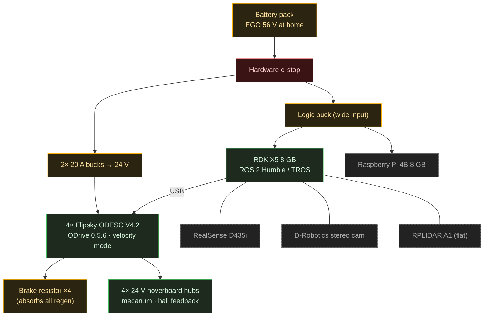

# 🔧 Beetle — what's on the robot now

*As-built, last updated November 2026. This page lists only what is physically on Beetle and working (or installed and idle). Plans are in
[`whats-next.md`](whats-next.md). The story of how it got here is in [`BUILD_LOG.md`](../BUILD_LOG.md).*

> Beetle is **partly disassembled** after a conference trip and is being rebuilt for Maker Faire Shenzhen.
> Operating mode: **teleop only**. No SLAM or autonomy is running.

## At a glance

Solid = running. Dashed = installed, not in use.

## Compute

- **RDK X5 (8 GB)** is the main computer, running D-Robotics Ubuntu with TogetheROS.Bot (ROS 2 Humble). It owns the safety chain,
  the teleop bridge, the motor link and BPU inference. Nodes come up through **systemd**.
  - Wired Ethernet `192.168.127.10`. USB-C device port is a USB network adapter at `192.168.128.10`, which is the direct-laptop fallback.
  - Lesson on record: RGB-D SLAM (RTAB-Map with depth) does not fit on the X5's A55 cores alongside everything else.
- **Raspberry Pi 4B 8 GB** is installed with no software yet. It's the future 2D SLAM coprocessor.
- **Steam Deck** is the operator console. It dual-boots Ubuntu and runs `deck_teleop.py` → UDP → `udp_cmdvel_node`, plus the CRT HUD.
- **RP2350 (MicroPython)** is the lidar scan-stage controller.

## Drivetrain

- **Mecanum**: four 24 V hoverboard hub motors, each on a **Flipsky ODESC V4.2**, in velocity control.
- **Suspension**: a trailing arm with a shock on every wheel. A rigid chassis lifts a wheel on uneven floors and breaks strafe kinematics.
- **Feedback**: hub hall sensors, `cpr = 90`. At 90 counts/rev the position hunts by one count at standstill, which is a sensor limit, not instability.
  AS5047P encoders (16,384 cpr) are **off the robot** waiting for new mounts.
- **Link**: USB to the X5. CAN is wired but has never worked.

**ODESC tuning (measured Sept 2026):**

| Parameter | Value | Note |
|---|---|---|
| `torque_constant` | **0.245** | Measured. The firmware default 0.04 was wrong, and so was a guessed 0.517 |
| `current_control_bandwidth` | **300** | Was 100, as a workaround for the wrong Kt |
| `vel_gain` | 2.45 | |
| `dc_max_positive_current` | 9 A per board | 36 A total vs. 40 A of buck capacity |
| `vel_integrator_gain` | low | Turned down after windup caused a lunge when a stall cleared |

Full driver reference: [`odesc_quick_reference.md`](odesc_quick_reference.md).

**Teleop mapping:** left stick = translation (vx, vy), right stick X = yaw, D-pad = speed trim. A **crab-lock** button strafes at full
lateral speed, exempt from the trim. That's because in velocity mode, trimming speed also trims push.

## Power

- **Packs:** EGO 56 V 5 Ah at home. Two Ryobi 40 V-class packs on the road (the EGO is ~280 Wh, which is over airline limits).
- **Motor bus: regulated 24 V** from two 20 A bucks, so top speed doesn't depend on which pack is plugged in. The bucks are one-way, so all regen
  goes to one ~2 Ω / 50 W brake resistor per ODESC.
- **Logic** runs on its own wide-input buck. The X5 is brownout-sensitive.
- ⚠️ The ODESC `vbus_voltage` reads the regulated 24 V, so **it is not a battery gauge**. There's no battery monitoring yet (sprint priority #3).

## Sensors

| Sensor | Status |
|---|---|
| RPLIDAR A1 | Mounted **flat** for future 2D SLAM. Can be swapped back onto the spinning stage for 3D capture |
| RealSense D435i | Mounted. Its IMU is the only IMU on the robot. RGB feeds the Deck camera view. Depth is off (CPU cost) |
| D-Robotics stereo camera | BPU-native, used for YOLO |

## Perception

- **YOLOv8n INT8** on the BPU (RDK Model Zoo), benchmarked in Stage 3 → [`benchmark.md`](benchmark.md). Not part of the current teleop setup.

## Safety

1. **Hardware e-stop** that cuts all power, independent of software
2. A single arbitrated command path to the motors
3. Command watchdog (0.3 s) + ODrive firmware watchdog
4. Software `/estop` latch
5. Proportional wheel-speed clamp (never per-side)
6. Release-to-stop deadman on the Deck

The full layer list is in [`architecture.md`](architecture.md#safety--single-path-to-the-motors).

## Expressive hardware

- **Eyes:** prototyped on a low-res LED ring and being replaced by a square grid (see [what's next](whats-next.md)).
- Voice, side display, shell: not on the robot yet.

## Which docs are current

| Doc | Era |
|---|---|
| this page, [`whats-next.md`](whats-next.md), [`BUILD_LOG.md`](../BUILD_LOG.md) | **Current** |
| [`architecture.md`](architecture.md), [`calibration.md`](calibration.md), [`benchmark.md`](benchmark.md), [`failure-recovery.md`](failure-recovery.md), [`deploy.md`](deploy.md), [`baseline_run.md`](baseline_run.md) | Stage 3 (skid steer). Accurate for that build, and most of it still applies |
| [`rdk-challenge/`](rdk-challenge/) | Competition record, frozen |
