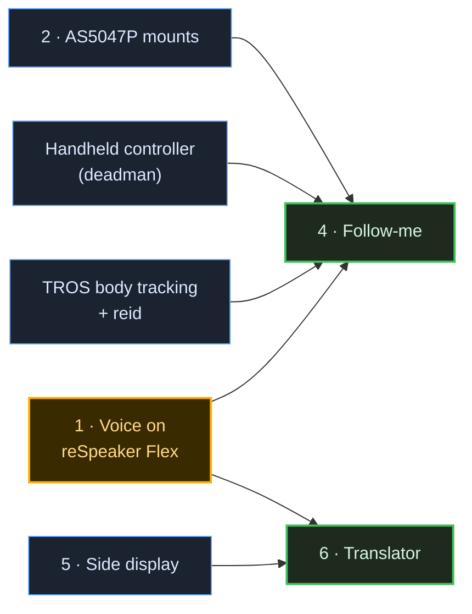
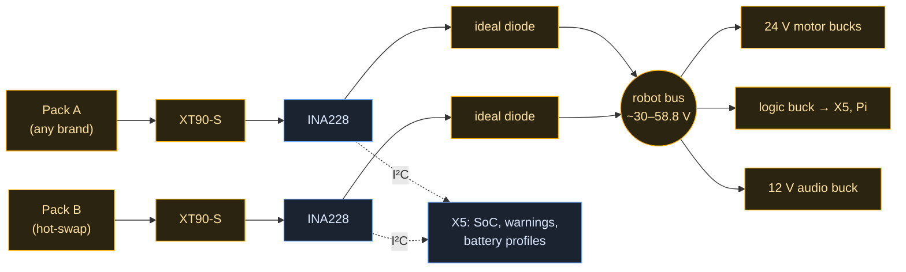

# 🧭 Beetle — what's next

*Plans, ideas and the shelf, last updated November 2026. What's built is in [`current-state.md`](current-state.md).*

**Status tags:** 🔨 **sprint** (being worked now) · 📐 **designed** (decisions made, not built yet) · 💡 **idea** · 📦 **shelved** (wanted eventually) · ✖ **retired** (decided against, kept here so it doesn't get relitigated)

## The Shenzhen sprint

Target: **Maker Faire Shenzhen, early December 2026.** Everything also has to survive another
disassemble → fly → reassemble cycle.

Eyes, voice and the shell come first, in parallel. Then the pieces stack up like this:

### 1 · Eyes 🔨
- A square LED grid made from tight-pitch strip, fitted into each eye dome. A coordinate table absorbs the imperfect fit.
- Layer stack: **googly physics → gaze → lids/brows → blink → glyph overlay**. Blinks are Poisson-timed and double as transition seams.
- A Pico renders through PIO. The X5 only sends expression ID, gaze, gain and a heartbeat. If the link drops, the eyes degrade in stages instead of freezing.
- First automatic triggers: tracked person → gaze, a voice → glance toward the speaker, low battery → tired, ODESC fault → alarm glyph.

### 1 · Voice 🔨
- **Seeed reSpeaker Flex** (XVF3800) on USB. It handles beamforming, noise suppression and echo cancellation on-chip.
- **All audio plays through the Flex's own amp**, because echo cancellation only works on audio the board itself plays.
- Stack: **sherpa-onnx**, which covers a custom "Hey Beetle" keyword spotter, Silero VAD, SenseVoice ASR (zh/en) and TTS.
- A deterministic command executor: exact phrase matches only, otherwise Beetle says "repeat?" **"Stop" always wins, and it's never the only stop path.**
- Beetle's own voice uses Speak & Spell-style LPC encoding of my own recordings.

### 1 · Shell 🔨
Green translucent acrylic, diffused so the lights hint through. Smoked-grey eyes. Weathered, lived-in cyberpunk. It must come apart for travel, keep the
mic array high and clear, and put a panel-mount USB-C debug port and quick battery-swap access on the outside.

### 2 · AS5047P mounts 📐
These go on the new wheel and suspension geometry. They give closed-loop velocity on 16,384 counts/rev instead of 90, which is a prerequisite for autonomy.
Afterwards the velocity integrator gets retuned, so push doesn't depend on commanded speed and crab-lock stops being a workaround.

### 3 · Power front end + battery monitoring 📐

- **Battery-agnostic**: one printed adapter per battery brand, all terminating in XT90-S. The bus accepts roughly 30–58.8 V (Ryobi, EGO, 48 V e-bike packs).
- **Hot-swap without a power cut**: ideal-diode ORing per pack. Packs are **never wired directly in parallel again**.
- **A real gauge**: an INA228 upstream of the bucks gives voltage, current and coulomb counting.
- **Tell the operator**: battery and ODESC errors go to the HUD, the eyes, the voice and the side display.

### 4 · Follow-me 📐
- The first autonomy, and it needs **no map**: a reactive controller holds a tracked person at a set bearing and distance.
- Target = a **tracked person ID** from TROS `mono2d_body_detection`. **`reid`** re-acquires the target after occlusion. Range comes from the flat lidar at that bearing.
- Voice commands ("closer", "stop", "come here") and **gestures from the followed person** as a loud-hall backup.
- Lose the target → stop, don't search. A handheld controller is the deadman; the hardware e-stop is the backstop.

### 5 · Side display 📐
An 80×16 WS2812B panel showing what Beetle heard, its current mode, how to interact, and low-battery warnings. Bilingual: one line of 16×16 CJK, or two lines of English.

### 6 · Translator mode 💡
VAD → SenseVoice (auto language ID) → OPUS-MT en↔zh → TTS. Consecutive, not simultaneous. There's a keyword mode for crowds and a conversation mode for quiet one-on-ones.

### 7 · 2D SLAM on the Pi 📐
`slam_toolbox` on the Pi, fed by the flat A1. The Pi publishes `map → odom`. **The ODESCs stay on the X5**, so there's never a network hop in the stop path.
A decimated depth band from the RealSense catches glass that the lidar sees straight through.

## Autonomy ladder 💡

## The shelf

| Item | Status | Why it's here |
|---|---|---|
| Limited-arc swerve | 📦 shelved | Fully designed in July ([build log ch. 3](../BUILD_LOG.md#chapter-3--the-swerve-that-wasnt)). Mecanum got holonomic motion first |
| CAN to the ODESCs | 💡 | Wired, never worked, still to debug |
| 36 V adult-hoverboard motors | 💡 | On hand. More torque, but they'd need new power electronics |
| Regenerative braking into the packs | 💡 parked | About 2% realistic energy gain for a slow indoor robot. Only worth doing as a learning project |
| Bigger compute payloads (RDK S100, Jetson Thor, sensor nodes) | 💡 | Optional payloads over Ethernet, with the base board staying the always-on spine |
| Trained policies | 💡 | Energy-aware locomotion, ball-pushing with the beetle horn |
| RTAB-Map on the X5, FAST-LIO on the spinning A1 | ✖ retired | CPU overload / the wrong fit (see [build log ch. 2](../BUILD_LOG.md#chapter-2--bring-up-on-a-cart)) |
| ODESC `vbus_voltage` as a battery gauge | ✖ retired | It reads the regulated 24 V |
